# Switches on a TV

Every key a theme can set (the Keys table in [`themes/README.md`](../themes/README.md)) gets a
screenshot of what it does on a real TV. This table is where they are listed: the repo and
[cleanyour.tv/addons#switches](https://cleanyour.tv/addons#switches) both show them from here.

## Adding a key

A new key needs a screenshot. Put it in `docs/switches/<key>.jpg` (an existing screenshot in the
repo that shows the key at work also counts) and add a row below:

- From a real TV, with the key set, as a JPEG or PNG, 16:9 (1280×720 is plenty), under 300 KB.
- Show where the key changes something you can see. For a key that maps a remote button, show the
  screen the button opens; for one that changes behaviour only, show the setting's effect, such as
  the panel, the menu or the app that comes up.
- Blur anything personal: Wi-Fi names, people, addresses.

`tests/test_switches.py` checks that every key has a row here with an image that exists and fits
the rules. Keys from before this rule are on its wanted list; a screenshot for one of them is welcome.

## Screenshots

| Key | Screenshot |
|---|---|
| `columns` |  |
| `sky_intensity` |  |
| `wallpaper_rotation_minutes` |  |
| `festival` |  |
| `settings_key_panel` |  |
| `home_idle_clock_minutes` |  |
| `clock_only` | 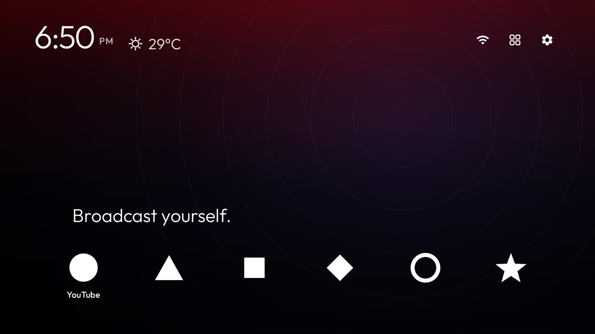 |
| `bare_buttons` |  |
| `plain_focus` |  |
| `more_apps` | 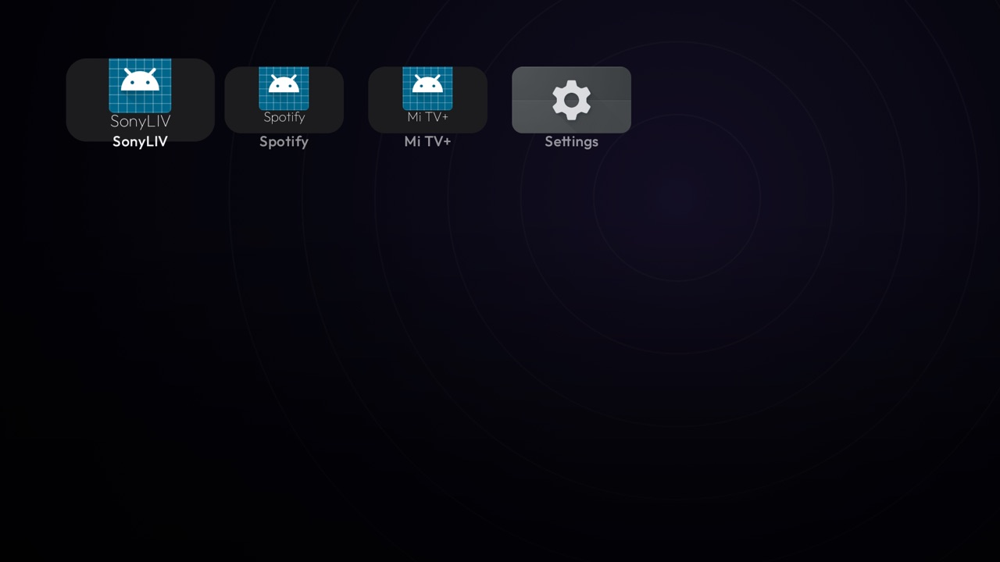 |
| `idle_fade_minutes` | 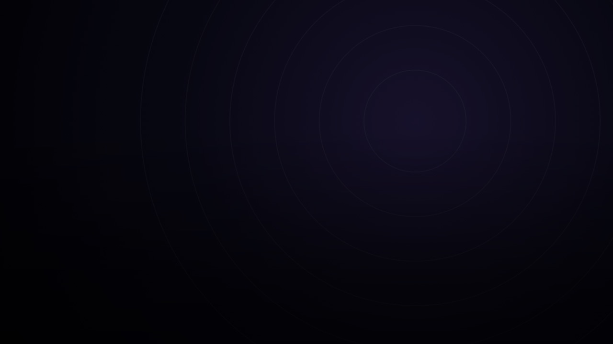 |
| `bottom_shade` |  |
| `weather_city` |  |
| `dock_logos` |  |
| `dock_logo_size` |  |
| `dock_taglines` |  |
| `app_colors` |  |
| `tagline_align` |  |
| `dock_bottom_room` |  |
| `scroll_dim` |  |
| `home_returns_to_last` | 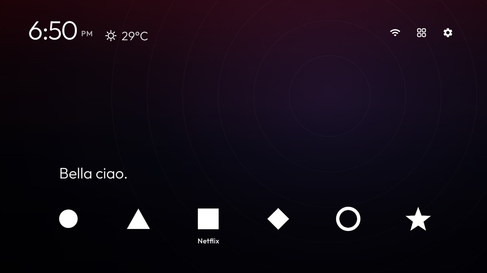 |
| `strict_dock_nav` | 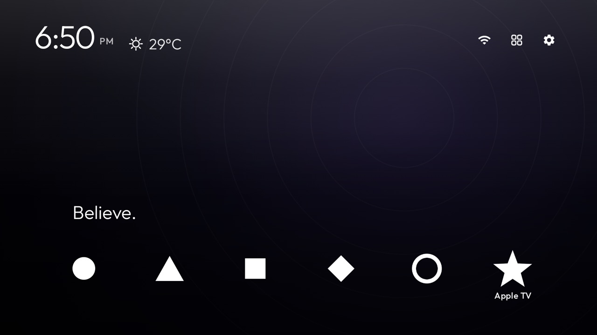 |
| `more_apps_names` |  |
| `tagline_rotate` | 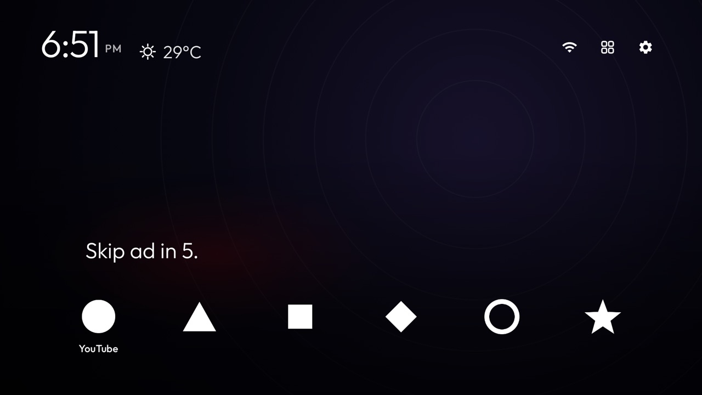 |
| `glow_strength` | 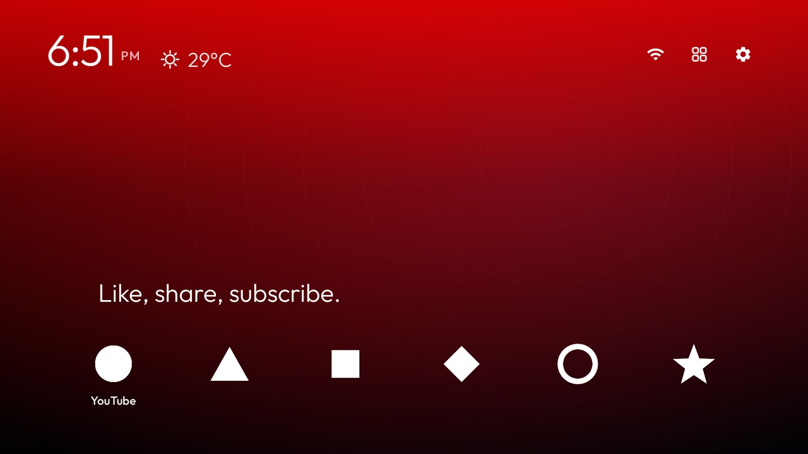 |
| `glow_size` |  |
| `focus_grow` |  |
| `focus_grow_ms` |  |
| `screensaver` | 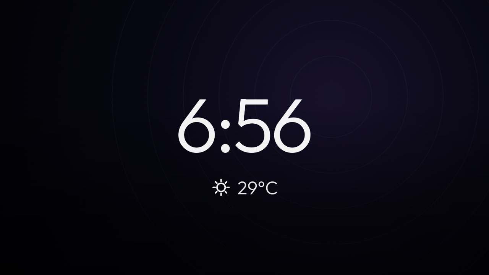 |
| `screensaver_dim` | 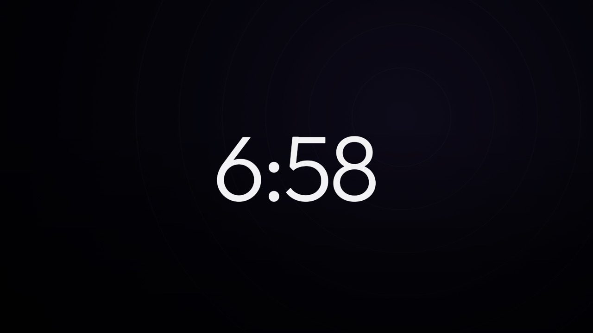 |
| `screensaver_fade_ms` |  |
| `screensaver_slide_minutes` | 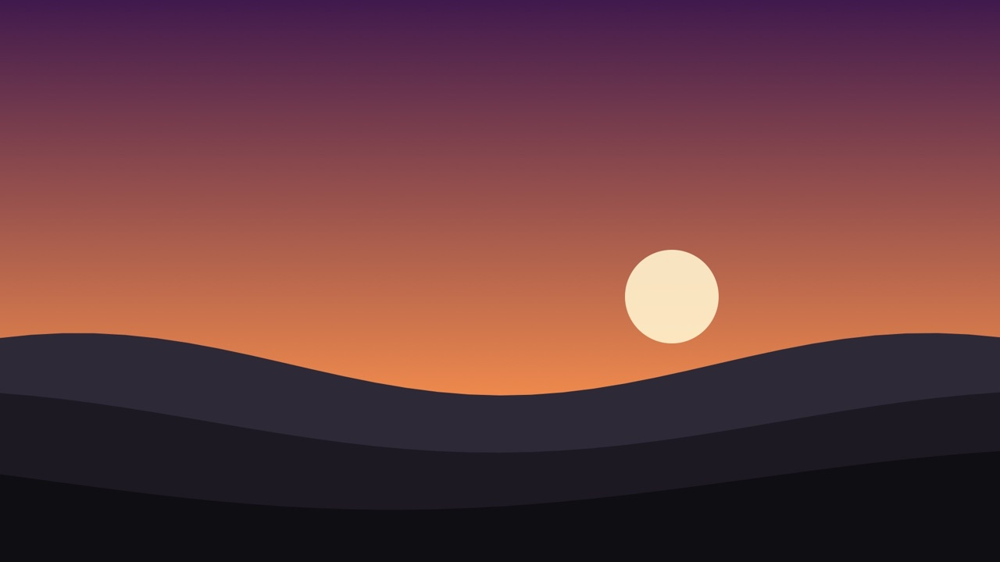 |
| `watchlist` | 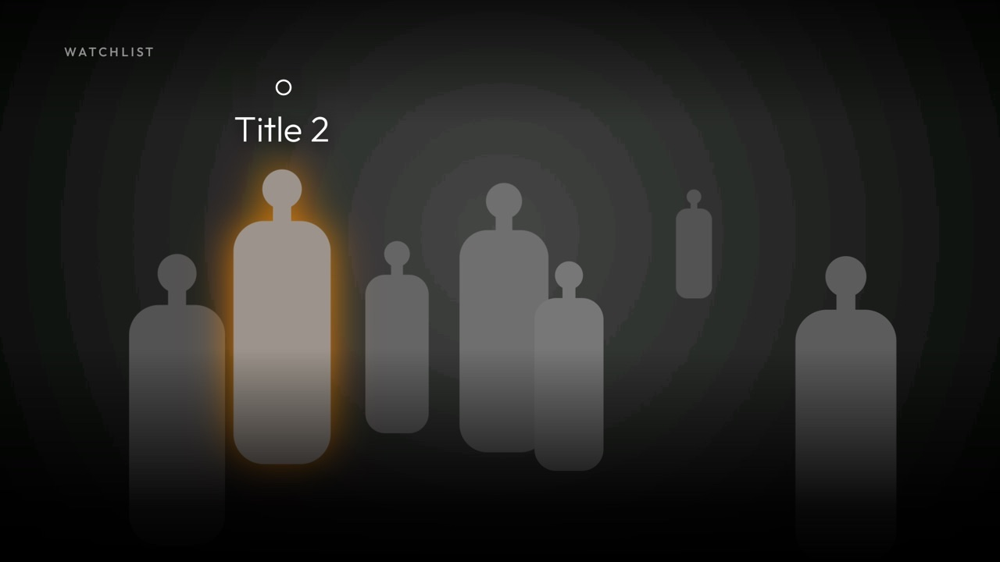 |
| `watchlist_items` |  |
| `watchlist_heading` |  |
